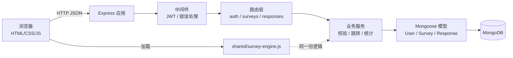
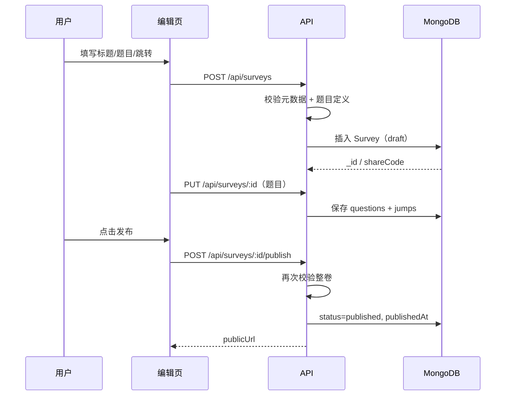
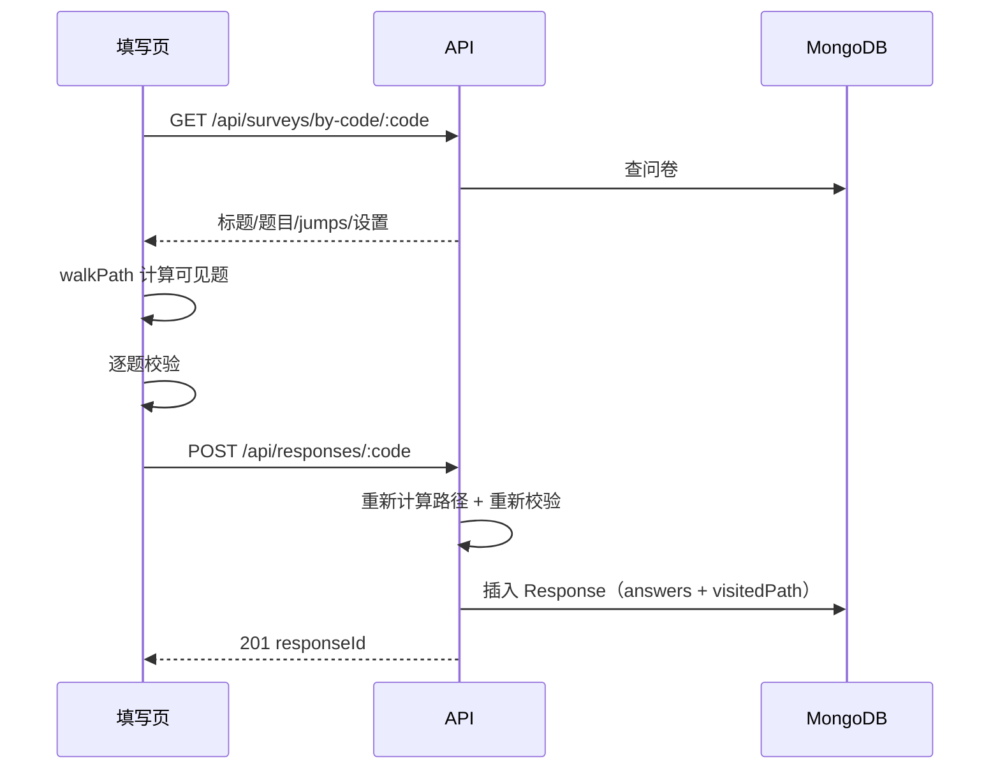
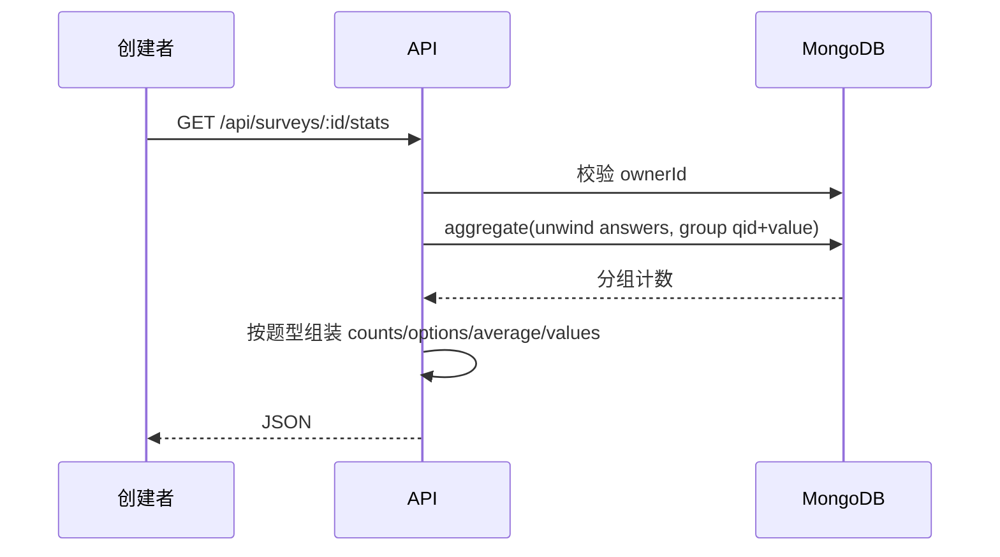

# 一、系统说明与总体设计

## 1.1 项目背景与目标

本项目实现一个简化版在线问卷系统，支持“注册用户创建问卷 → 通过链接分发 → 用户填写 → 创建者看统计”的完整闭环。重点不是页面数量，而是：

1. 用 MongoDB 的文档模型合理表达问卷、题目、跳转规则和答卷；
2. 后端对题型、数量、范围、跳转路径做可信校验；
3. 将跳转和校验逻辑做成可配置数据，而不是写死在代码中；
4. 有可重复执行的测试和完整的开发文档。

## 1.2 角色与权限

| 角色 | 能做什么 | 权限边界 |
| --- | --- | --- |
| 游客 | 打开允许匿名的已发布问卷、提交答卷 | 看不到他人问卷列表、统计和答卷明细 |
| 登录用户 | 创建/编辑自己的问卷、发布、关闭、查看自己的统计；填写他人问卷 | 只能操作 `ownerId = 当前用户` 的问卷 |
| 问卷创建者 | 管理问卷、预览草稿、查看统计与答卷明细 | 发布后题目结构锁定；关闭后不能继续收卷 |

鉴权使用 JWT（`Authorization: Bearer <token>`）。登录态保存在浏览器 localStorage；服务端不依赖 session。

## 1.3 需求与实现对照

| 初始需求 | 实现位置 | 验证方式 |
| --- | --- | --- |
| 注册、登录、注册时间 | `src/routes/auth.js`、`User` 模型 | `tests/auth.test.js` |
| 只能看到自己的问卷 | `GET /api/surveys` 按 `ownerId` 过滤 | `survey.test.js` 用户隔离用例 |
| 创建问卷、标题、说明、匿名设置 | `POST /api/surveys` | `survey.test.js` |
| 查看列表、发布、截止时间、关闭 | `GET /api/surveys`、`publish`、`close` | `survey.test.js` |
| 分享链接 `/survey/xxxxxx` | `shareCode` + `app.get('/survey/:code')` | 端到端检查 |
| 填写者登录要求 | `allowAnonymous=false` 时服务端 401 | `submission.test.js` |
| 单选/多选/文本/数字 | `shared/survey-engine.js`、编辑页 | `jump.test.js`、`validation.test.js` |
| 多选题 min/max | `validateAnswer` + 聚合统计 | `validation.test.js` |
| 文本长度、数字范围/整数 | `validateAnswer` | `validation.test.js` |
| 按单选/多选/数字跳转 | `jumps` 数组 + `walkPath` | `jump.test.js`、`submission.test.js` |
| 跳转不写死 | 规则存于 `surveys.questions[].jumps` | 数据库样例、编辑页 |
| 自动跳题、错误提示 | `public/fill.html` + 服务端校验 | 手工用例 + API 测试 |
| 多人/匿名/重复填写 | `Response` 多文档；`allowAnonymous`/`allowMultiple` | `submission.test.js` |
| 统计计数、文本、平均值 | `src/services/stats.js` 聚合 | `stats.test.js` |
| 整卷/单题统计 | `GET /api/surveys/:id/stats?qid=` | `stats.test.js` |

## 1.4 总体架构

分层职责：

| 层 | 文件 | 职责 |
| --- | --- | --- |
| 展示层 | `public/*.html`、`public/js/common.js` | 页面交互、表单渲染、调用 API、展示统计 |
| 接口层 | `src/routes/*.js` | 参数提取、权限、HTTP 状态码、错误转换 |
| 业务层 | `shared/survey-engine.js`、`src/services/stats.js` | 题型校验、跳转路径、统计聚合 |
| 数据层 | `src/models/*.js`、`scripts/init-db.js` | Mongoose Schema、索引、MongoDB JSON Schema |
| 基础设施 | `src/db.js`、`src/config.js`、`src/server.js` | 连接、配置、启动与退出 |

## 1.5 页面与路由

| 地址 | 页面 | 说明 |
| --- | --- | --- |
| `/login.html` | 登录/注册 | 注册后直接登录；支持 `?next=` 回跳 |
| `/dashboard.html` | 我的问卷 | 列表、发布、复制链接、关闭、删除草稿 |
| `/edit.html` | 新建/编辑问卷 | 元数据、题型、选项、校验参数、跳转规则 |
| `/survey/:code` | 填写问卷 | 按跳转动态显示题目 |
| `/stats.html?id=...` | 统计 | 整卷 / 单题统计 |
| `/api/health` | 健康检查 | 返回服务与数据库连接状态 |
| `/shared/survey-engine.js` | 共享脚本 | 浏览器端加载的纯逻辑模块 |

## 1.6 关键业务流程

### 创建与发布

### 填写与提交

### 统计

## 1.7 设计原则

1. **数据库只存事实，统计不落冗余计数**：统计从 Response 聚合，避免计数与真实答卷不一致。
2. **服务端是最终裁判**：浏览器的即时校验只改善体验，所有规则在提交接口重新执行。
3. **规则数据化**：跳转条件存在问卷文档中，新增题型/条件时优先扩展规则解释器。
4. **结构一经发布即冻结**：避免历史答卷指向已经改名的题目或选项。
5. **小而清晰的分层**：路由不直接写复杂校验；纯逻辑集中在共享引擎中，便于单元测试。

## 1.8 非功能设计与安全

- 密码只保存 bcrypt 哈希，不返回 `passwordHash`。
- JWT 默认 7 天过期；生产环境必须设置随机 `JWT_SECRET`。
- 所有管理接口都校验 `ownerId`，越权统一返回 404，避免泄露资源是否存在。
- 输入长度有上限（标题 120、说明 2000、题目 100 道、选项 26+ 等），JSON body 限制 1 MB。
- 前端使用 `textContent` / 转义函数渲染用户内容，降低 XSS 风险。
- 设置 `X-Content-Type-Options`、`X-Frame-Options`、`Referrer-Policy` 基础响应头。
- 错误响应不返回堆栈；4xx 不打印完整错误栈。

## 1.9 第一阶段范围与后续演进

已实现：账号、问卷 CRUD、四种题型、跳转、校验、发布/关闭/截止、匿名与重复填写、统计、测试和文档。

暂未实现（不虚构）：

- 图形化拖拽排序/题目分组；
- 文件上传题、矩阵题、评分题；
- 团队协作、问卷模板；
- 邮件/短信邀请；
- 第二阶段尚未发布的变更需求。

为第二阶段预留：

- `schemaVersion` 支持数据结构迁移；
- `status` 状态机可扩展 `archived` 等状态；
- `jumps` 是数组，可增加新条件类型；
- `Response.visitedPath` 和 `schemaVersion` 便于审计旧数据；
- 共享引擎可同时被新 API / 新页面复用。
