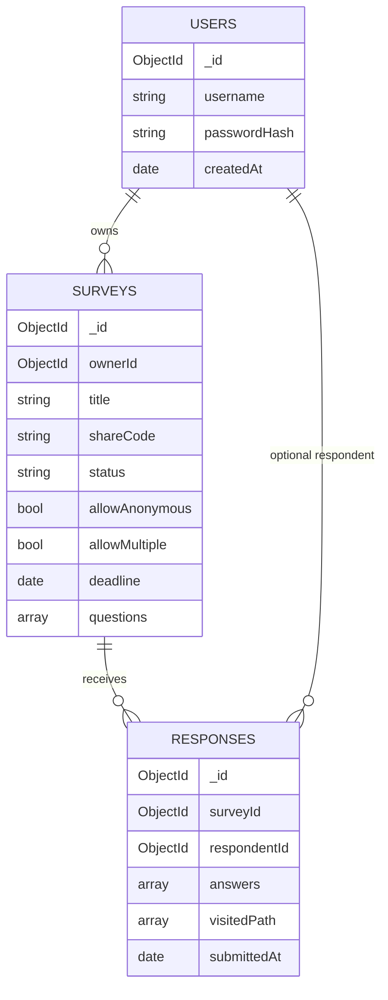

# 二、MongoDB 数据库设计

## 2.1 设计目标

数据库需要同时满足：

1. 一份问卷包含多道题，每题可能有不同字段和跳转规则；
2. 一次填写需要按顺序读整卷、按跳转计算路径，并原子保存一份答卷；
3. 统计需要按“问卷 → 题目 → 答案值”聚合；
4. 允许后续需求变更，但不能随意破坏已提交数据；
5. 不使用关系数据库，不把所有数据塞进一个集合。

## 2.2 集合总览



共三个集合（第二阶段另新增四个题库相关集合，见 2.11）：

| 集合 | 文档粒度 | 数量级假设 |
| --- | --- | --- |
| `users` | 一个账号一份文档 | 小 |
| `surveys` | 一份问卷（题目作为子文档） | 中 |
| `responses` | 一份答卷（答案作为子文档） | 大 |

**没有把所有数据放进一个集合**：账号、问卷定义、答卷的生命周期、权限和查询方式都不同。混在一起会让索引和权限判断变复杂，也无法针对答卷量单独扩展。

## 2.3 users 集合

```javascript
{
  _id: ObjectId("..."),
  schemaVersion: 1,
  username: "demo",
  passwordHash: "$2a$10$...",   // 只存哈希
  createdAt: ISODate("2026-10-22T10:00:00Z")
}
```

约束：

- `username` 唯一、trim、长度 3–32；
- `passwordHash` 必填；
- `createdAt` 由 Mongoose `timestamps` 生成；
- 不保存明文密码、盐值单独存储没有必要（bcrypt 哈希内含盐）。

索引：

| 索引 | 用途 |
| --- | --- |
| `{ username: 1 } unique` | 登录查询、并发注册防重 |

## 2.4 surveys 集合

### 文档结构

```javascript
{
  _id: ObjectId("..."),
  schemaVersion: 1,
  ownerId: ObjectId("..."),
  title: "课程反馈",
  description: "请花 1 分钟填写",
  allowAnonymous: true,
  allowMultiple: true,
  status: "published",             // draft | published | closed
  deadline: ISODate("2026-12-31T15:59:59Z"),
  shareCode: "a1b2c3d4e5f6",
  questions: [
    {
      qid: "q1",
      type: "single",
      title: "你是否使用过本系统？",
      required: true,
      order: 0,
      options: [
        { key: "A", label: "使用过" },
        { key: "B", label: "没有" }
      ],
      minSelect: null,
      maxSelect: null,
      minLength: null,
      maxLength: null,
      min: null,
      max: null,
      integerOnly: false,
      jumps: [
        { when: { option: "A" }, goto: "q3" },
        { when: { option: "B" }, goto: null }
      ]
    },
    {
      qid: "q3",
      type: "multi",
      title: "你喜欢哪些题型？",
      required: true,
      order: 1,
      options: [
        { key: "A", label: "单选" },
        { key: "B", label: "多选" }
      ],
      minSelect: 1,
      maxSelect: 2,
      jumps: []
    }
  ],
  publishedAt: ISODate("2026-10-22T10:00:00Z"),
  closedAt: null,
  createdAt: ISODate("2026-10-22T09:59:00Z"),
  updatedAt: ISODate("2026-10-22T10:00:00Z")
}
```

### 为什么题目嵌入 Survey

- 填写页需要**一次拿到整卷**，包括题目、选项、校验参数、跳转规则；
- 题量有限（本系统限制 100 道），不会无限增长；
- 题目和问卷是同生命周期的主从关系，单独建 `questions` 集合会引入无意义的 join；
- 更新整卷（草稿阶段）时可以用一次文档写入保证一致性。

### 为什么选项也嵌入题目

选项只属于当前题，数量少；统计时通过 `key` 映射 label，不需要单独的选项集合。

### 跳转规则结构

`jumps` 是数组，数组顺序即优先级。每条规则：

```javascript
{
  when: { ... },   // 条件对象，按题型不同而不同
  goto: "q3"       // 目标 qid；null 表示结束问卷
}
```

条件对象是“多态”的，字段由 `type` 决定：

| 题型 | when 示例 | 含义 |
| --- | --- | --- |
| single | `{option:"A"}` | 选择 A |
| multi | `{includes:"A"}` | 包含 A |
| multi | `{countAtLeast:2}` | 至少选 2 个 |
| multi | `{countAtMost:3}` | 最多选 3 个 |
| multi | `{countEquals:2}` | 恰好 2 个 |
| number | `{op:">=", value:18}` | 数值 ≥ 18 |

`goto` 为目标题目的 `qid`，不是题目数组下标。原因是数组下标会随增删题变化，而 qid 在草稿编辑期间保持稳定，适合被规则引用。

### 状态字段

| 状态 | 含义 | 是否可填写 |
| --- | --- | --- |
| `draft` | 草稿 | 仅创建者预览 |
| `published` | 已发布 | 是（未截止、未关闭） |
| `closed` | 已关闭 | 否 |

### 发布后冻结结构

发布后只允许修改标题、说明、匿名/重复设置和截止时间，不允许修改 `questions`。原因是 `responses.answers` 只保存 qid 和值，如果发布后改题：

- 旧答卷的 q1 可能对应新题目的另一句话；
- 已删除选项的 key 可能出现在历史统计中；
- 跳转路径无法重放。

因此把“结构版本”问题在业务层直接封住；后续第二阶段如确需改题，应新增问卷版本字段，而不是原地修改。`schemaVersion` 字段为这种迁移预留。

### 索引

| 索引 | 用途 |
| --- | --- |
| `{ shareCode: 1 } unique` | 公开链接单文档查找、避免分享码冲突 |
| `{ ownerId: 1, createdAt: -1 }` | “我的问卷”按时间倒序 |
| `{ status: 1, deadline: 1 }` | 运营扫描已发布/到期问卷（预留） |

## 2.5 responses 集合

### 文档结构

```javascript
{
  _id: ObjectId("..."),
  schemaVersion: 1,
  surveyId: ObjectId("..."),
  respondentId: ObjectId("...") || null,  // 匿名时为 null
  submittedAt: ISODate("2026-10-22T10:05:00Z"),
  visitedPath: ["q1", "q3", "q4"],
  answers: [
    { qid: "q1", value: "A" },
    { qid: "q3", value: ["A", "B"] },
    { qid: "q4", value: 25 }
  ]
}
```

设计要点：

1. **一份答卷一个文档**：插入是单文档原子操作；查看/导出一份答卷一次读取完成。
2. **答案只存 qid + 值**：题干、选项 label 在 Survey 中维护，避免每条答卷重复存储长文本。
3. **值类型按题型变化**：single/text 为 string，multi 为 string 数组，number 为 number；`Mixed` 允许这种多态。
4. **保存 `visitedPath`**：记录实际答题路径，便于审计跳转；即使未来题目改版，也能知道当时用户走过哪些题。
5. **匿名不伪造用户**：`respondentId: null`，不把匿名者映射成某个“匿名用户”。
6. **`surveyId` 引用而非嵌入整个问卷**：答卷只引用问卷，避免每份答卷复制题目定义。

### 索引

| 索引 | 用途 |
| --- | --- |
| `{ surveyId: 1, submittedAt: -1 }` | 某问卷的答卷列表/统计扫描 |
| `{ surveyId: 1, respondentId: 1 }` | 判断登录用户是否已填（allowMultiple=false） |
| `{ surveyId: 1, "answers.qid": 1 }` | 按题过滤/扩展分析（预留） |

没有对 `respondentId` 建全局唯一索引，因为：

- `allowMultiple=true` 时同一用户可多次填写；
- 匿名答卷的 `respondentId` 为 null，全局唯一会阻止第二份匿名答卷；
- MongoDB 唯一索引不能按问卷的 `allowMultiple` 动态生效。

因此重复限制在应用层按 `surveyId + respondentId` 查询实现，并在文档中说明匿名场景无法可靠去重。

## 2.6 MongoDB JSON Schema 校验

`scripts/init-db.js` 在数据库层创建 `$jsonSchema` 校验器：

- `users`：用户名长度、密码哈希长度、createdAt 日期；
- `surveys`：ownerId 为 ObjectId、status 枚举、questions 数组、题型枚举、jump.goto 为 string/null；
- `responses`：surveyId 为 ObjectId、answers 数组元素必须含 qid/value、visitedPath 为字符串数组。

Mongoose 是应用层第一道校验，MongoDB JSON Schema 是第二道防线。即使有人绕过 API 直接写数据库，也插不进缺少 `username` 或 `surveyId` 的文档。初始化后可直接验证：

```javascript
db.users.insertOne({ username: "x" })
// MongoServerError: Document failed validation (code 121)
```

注意：JSON Schema 只做结构性保护，**业务规则**（如“多选至少 2 个”“跳转只能向后”）仍由共享引擎执行，因为 JSON Schema 无法表达跨字段、跨数组的条件逻辑。

## 2.7 为什么不使用关系数据库

假设用关系模型，至少需要：

- `users`
- `surveys`
- `questions`（或 `survey_questions`）
- `question_options`
- `jumps`
- `responses`
- `answers`

填写一份问卷要 join 5–7 张表；不同题型的配置字段不同，通常会变成大量可空列或 EAV 表。MongoDB 的优势正好对应本项目：

1. **聚合根清晰**：Survey 是题目/选项/跳转的聚合根，Response 是答案的聚合根，天然适合文档。
2. **多态题型**：single/multi/text/number 的配置字段差异大，文档可只保存相关字段；关系表需要大量 NULL 列或子表。
3. **整卷读取**：填写页只需要一次查询，无须 join。
4. **跳转规则嵌套**：规则属于题目，嵌入后读写一致。
5. **统计聚合**：`$unwind` + `$group` 直接按答案值分组。

当然，关系数据库在强约束、复杂跨表报表上更强；本项目的取舍是“填写/统计路径简单、结构可演进”。

## 2.8 冗余与一致性

| 数据 | 是否冗余 | 处理 |
| --- | --- | --- |
| 选项 label | 只存 Survey，不存 Response | 统计时用 key 映射 label |
| 答卷总数 | 不存计数器 | 每次 `countDocuments` / 聚合，避免计数器漂移 |
| 题目标题 | 不存 Response | 发布后冻结结构，保证可解释 |
| 用户名 | Response 只存 userId | 需要时 join/populate，避免改名不一致 |
| 统计结果 | 不持久化 | 实时聚合；数据量增大后可加缓存/物化视图 |

**没有做的冗余**：把整份问卷快照复制到每份答卷。它会让数据量成倍增长；第一阶段用“发布后冻结结构”解决一致性问题。若第二阶段要求发布后改题并保留旧答卷语义，再引入 `surveyRevision` 或 `questionSnapshot`。

## 2.9 数据量估算

- 单问卷最多 100 题，单答卷答案数 ≤100；
- 一份答卷通常 < 10 KB，100 万份约 10 GB 量级；
- 单文档 16 MB 限制远未触及；
- 统计聚合按 `surveyId` 命中索引，再 `$unwind`，适合单问卷几千到几十万份答卷。

当单问卷答卷达到千万级时，应改为增量统计集合或按时间分片；这超出第一阶段范围，已在报告中说明。

## 2.10 初始化与示例数据

```bash
pnpm db:init   # 创建集合、validator、索引
pnpm seed      # demo / demo123，含 3 份答卷
```

数据库名默认 `survey_app`，通过 `MONGO_URI` 修改。

---

## 2.11 第二阶段扩展：题库与版本

第二阶段新增四个集合，原有三集合保留。

### questionbanks（题库）

```javascript
{
  _id, schemaVersion: 2,
  ownerId, name, description, isDefault,
  createdAt, updatedAt
}
```

- `{ownerId, name}` 唯一；
- `{ownerId, isDefault}` 部分唯一索引，保证一个用户只有一个默认题库；
- 默认题库由 `ensureDefaultBank` 懒创建。

### questions（逻辑题）

```javascript
{
  _id, schemaVersion: 2,
  ownerId, bankId,
  title, type, currentVersion, currentVersionId,
  archivedAt, forkedFromQuestionId, forkedFromVersionId,
  createdAt, updatedAt
}
```

- `title/type` 是当前版本缓存；
- `currentVersionId` 指向不可变版本；
- `forkedFrom*` 记录另存来源；
- 软归档 `archivedAt`，不物理删除。

### questionversions（不可变版本）

```javascript
{
  _id, questionId, ownerId, version,
  title, type, options,
  minSelect, maxSelect, minLength, maxLength, min, max, integerOnly,
  parentVersionId, restoredFromVersionId,
  changeNote, createdBy, createdAt
}
```

- 只新增，不更新；
- `{questionId, version}` 唯一；
- 恢复旧版 = 复制内容生成新版本，保留 `restoredFromVersionId`；
- 类型不可跨版本变化。

### questionshares（共享）

```javascript
{
  _id, questionId, ownerId, sharedWithUserId,
  permission: "use", createdAt
}
```

- `{questionId, sharedWithUserId}` 唯一；
- 只授予使用权；编辑/共享/统计仍属所有者。

### 2.11.1 Survey 可选来源字段

```javascript
questions: [{
  ...第一阶段字段,
  sourceQuestionId: ObjectId | null,
  sourceVersionId: ObjectId | null,
  sourceVersion: Number | null
}]
```

**题目内容仍然保存快照**，来源字段只用于追踪和反查。题库改版不会改变旧问卷。

索引：

```javascript
surveySchema.index({ 'questions.sourceQuestionId': 1 });
surveySchema.index({ 'questions.sourceVersionId': 1 });
```

### 2.11.2 Response 可选来源字段

```javascript
answers: [{
  qid, value,
  questionId: ObjectId | null,
  questionVersionId: ObjectId | null
}]
```

索引：

```javascript
responseSchema.index({ 'answers.questionId': 1, submittedAt: -1 });
```

跨问卷统计直接匹配 `answers.questionId`，不需要扫描 Survey 再拼 qid。

### 2.11.3 为什么同时保留“快照”和“来源”

| 方案 | 旧问卷不受题库影响 | 跨问卷统计 | 内容冗余 |
| --- | --- | --- | --- |
| 只存 questionId，实时读题库 | 否（题库改则旧问卷变） | 容易 | 少 |
| 只存快照，不存 ID | 是 | 困难 | 中 |
| **快照 + 来源 ID（本项目）** | **是** | **容易** | **中** |

这是本阶段最重要的取舍：宁可接受有限的内容冗余，也要保证历史问卷的语义稳定。

### 2.11.4 JSON Schema 扩展

`scripts/init-db.js` 新增：

- `questionbanks` / `questions` / `questionversions` / `questionshares` 四个 validator；
- Survey questions 的 source 字段；
- Response answers 的 questionId/versionId；
- 对应索引。

旧集合用 `collMod` 更新 validator，不删除旧文档。

### 2.11.5 数据迁移

`pnpm migrate:stage2`：

- 为每个用户补默认题库；
- 为来源问卷补版本；
- 为来源答卷补 questionId/versionId。

旧数据不迁移也能读；迁移脚本可重复执行。

### 2.11.6 第二阶段索引汇总

| 集合 | 索引 | 用途 |
| --- | --- | --- |
| questionbanks | `{ownerId,name}` unique | 防重名 |
| questionbanks | `{ownerId,isDefault}` partial unique | 一个默认题库 |
| questions | `{ownerId,bankId,updatedAt}` | 题库列表 |
| questions | `{title:'text'}` | 搜索（预留） |
| questionversions | `{questionId,version}` unique | 版本唯一 |
| questionshares | `{questionId,sharedWithUserId}` unique | 防重复共享 |
| questionshares | `{sharedWithUserId,createdAt}` | 共享给我 |
| surveys | `questions.sourceQuestionId` | 使用情况 |
| responses | `answers.questionId` | 跨问卷统计 |


