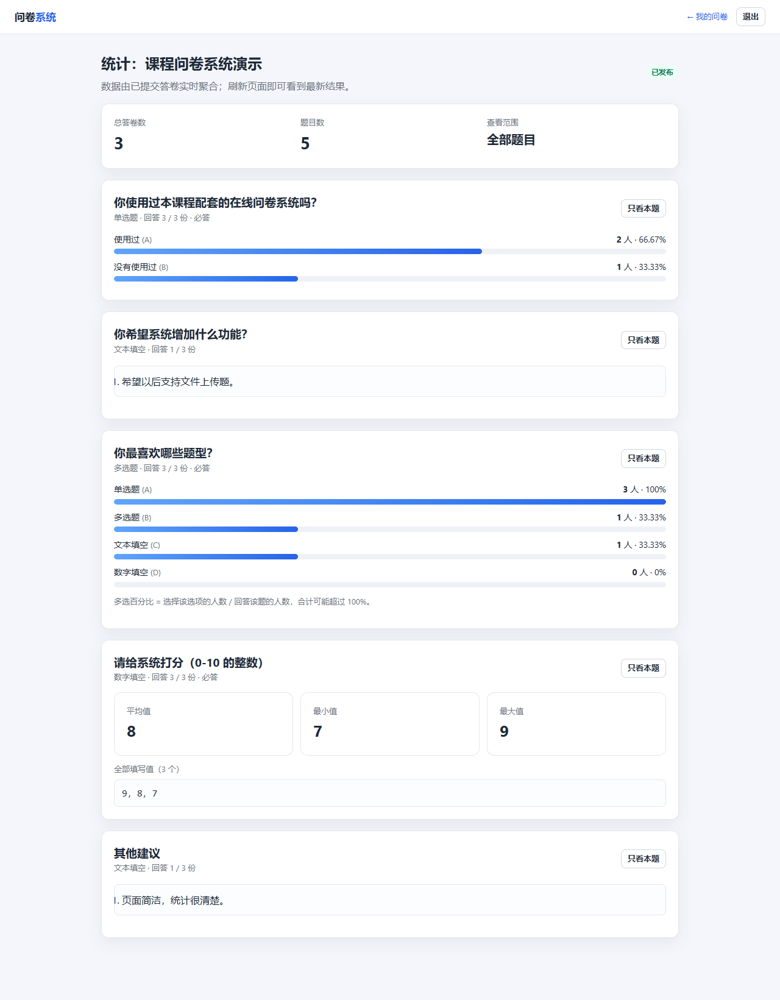
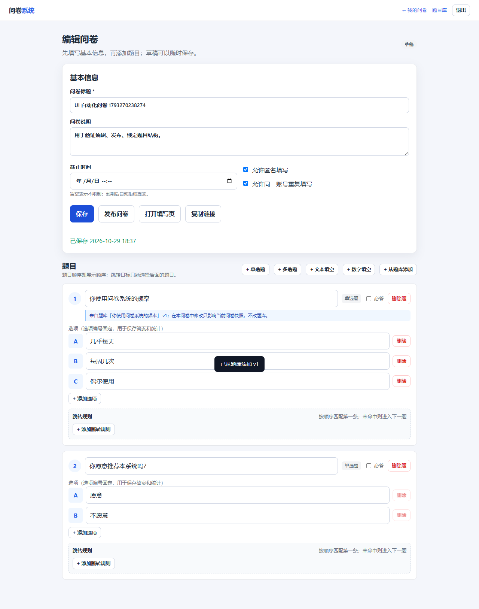
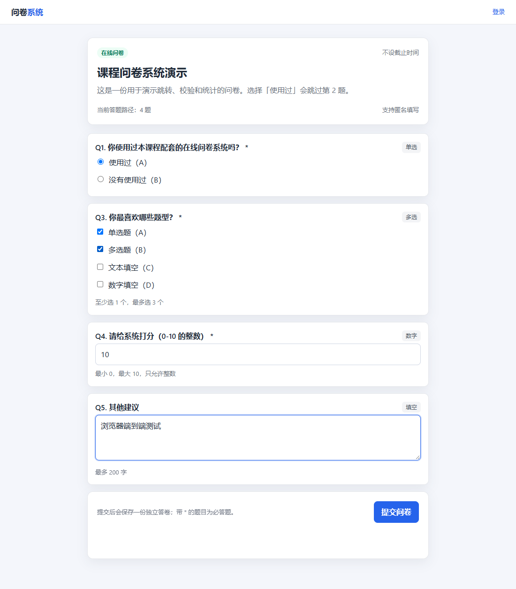

# 七、项目完成报告（第一阶段）

> 本文是第一阶段报告，保留当时的原始设计记录。第二阶段（题目库、版本、共享、跨问卷统计）已经完成，见 [第二阶段项目完成报告](10-第二阶段项目完成报告.md)。

| 项目 | 内容 |
| --- | --- |
| 课程项目 | 基于 MongoDB 的问卷系统开发 |
| 阶段 | 第一阶段：初始需求设计与实现 |
| 技术栈 | Node.js + Express + MongoDB + Mongoose + 原生前端 |
| 报告日期 | 2026-10-22 |
| 姓名/学号 | ____________________ |

---

## 摘要

本项目实现了一个简化版在线问卷系统，覆盖“注册登录 → 创建问卷 → 配置题目/校验/跳转 → 发布链接 → 登录或匿名填写 → 实时统计”的完整流程。系统使用 MongoDB 三个集合分别保存用户、问卷和答卷；题目、选项、跳转规则作为问卷的子文档，答案作为答卷的子文档。跳转与校验实现为前后端共用的纯逻辑模块，服务端在提交时重新计算路径并重新校验，避免客户端绕过。项目包含 70 个自动化测试、数据库 JSON Schema 校验、索引设计、完整 API 文档和 AI 使用日志。

本报告对应**第一阶段**；第二阶段需求变更尚未发布，因此不虚构“已完成变更”。报告最后一节说明现有设计对第二阶段的兼容性预案。

---

## 1. 项目目标

### 1.1 功能目标

1. 用户注册、登录，只能管理自己的问卷；
2. 创建问卷，设置标题、说明、匿名、重复填写、截止时间；
3. 支持单选、多选、文本填空、数字填空；
4. 支持按单选、多选、数字结果配置跳转；
5. 填写时自动跳转、即时校验、提交后保存；
6. 创建者查看整卷或单题统计。

### 1.2 技术目标

- 所有业务数据保存在 MongoDB，不使用关系数据库；
- 不使用现成问卷系统框架；
- 数据库设计能解释“为什么这样分集合/嵌入/引用”；
- 跳转规则不写死在程序里；
- 有可运行的代码、配置说明、API 说明、测试用例、AI 使用记录。

### 1.3 非目标

第一阶段不追求复杂 UI、拖拽编辑、文件上传、团队协作、邮件邀请。界面以“能完成业务、可读、可演示”为准。

---

## 2. 需求分析与范围

### 2.1 初始需求拆解

| 需求域 | 具体需求 | 实现 |
| --- | --- | --- |
| 账号 | 注册、登录、注册时间 | JWT + bcrypt + `createdAt` |
| 权限 | 只看自己的问卷 | 所有管理接口带 `ownerId` 条件 |
| 问卷 | 标题、说明、匿名、截止、发布、关闭、链接 | Survey 模型 + 状态机 + shareCode |
| 题型 | 单选、多选、文本、数字 | `type` 多态 + 子文档 |
| 校验 | 必答、多选数量、文本长度、数字范围/整数 | 共享引擎 + 服务端复检 |
| 跳转 | 单选/多选/数字条件 | `jumps` 数组 + `walkPath` |
| 填写 | 顺序、跳转、错误提示、提交、多人、匿名、重复 | fill 页面 + Response |
| 统计 | 选项计数、总人数、多选次数、文本、数字平均 | 聚合管道 |

### 2.2 与初始需求的差异/补充

为了实现“同一个人填写多次（如果允许）”，增加了问卷字段：

- `allowMultiple`（默认 `true`）：是否允许同一登录账号重复填写。

为了避免发布后改题导致历史答卷失真，增加约束：

- 发布后锁定题目结构，只允许改标题/说明/截止时间/匿名/重复设置。

为了支持统计和审计，增加：

- `publishedAt`、`closedAt`、`Response.visitedPath`、`schemaVersion`。

这些是合理扩展，不删除初始需求中的任何功能。

---

## 3. 系统设计

### 3.1 架构

```text
浏览器（HTML/CSS/JS）
   │  HTTP JSON
   ▼
Express
   ├─ 中间件：JWT、错误处理、安全响应头
   ├─ 路由：/api/auth /api/surveys /api/responses
   ├─ 业务：survey-engine（校验/跳转）、stats（聚合）
   └─ 模型：User / Survey / Response
          │
          ▼
       MongoDB
```

详细分层、时序图、页面路由见 `docs/01-系统说明.md`。

### 3.2 模块职责

| 模块 | 职责 |
| --- | --- |
| `routes/auth` | 注册、登录、当前用户 |
| `routes/surveys` | 问卷 CRUD、发布、关闭、公开读取、统计入口 |
| `routes/responses` | 提交答卷、答卷明细 |
| `shared/survey-engine` | 纯逻辑：校验、跳转、题目定义校验（前后端共用） |
| `services/stats` | MongoDB 聚合统计 |
| `models` | 数据结构和索引 |
| `middleware/auth` | JWT 签发/验证 |
| `middleware/error` | 统一错误响应 |

### 3.3 设计取舍

1. **单体应用**：课程项目规模小，前后端同仓库、同进程部署，减少运维复杂度。
2. **原生前端**：不引入 React/Vue，页面逻辑直接可读，答辩时容易说明。
3. **JWT 而非 session**：无状态、适合链接分享；token 存 localStorage，配合前端转义降低 XSS 风险。
4. **共享引擎而非两份逻辑**：降低前后端规则漂移。
5. **发布后冻结结构**：用业务约束换数据一致性，避免过早引入版本化复杂度。

---

## 4. MongoDB 设计

### 4.1 三个集合

- `users`：账号；
- `surveys`：问卷 + 题目 + 选项 + 跳转规则（嵌入）；
- `responses`：一份答卷 + 答案 + 实际路径（嵌入）。

### 4.2 为什么这样设计

- **题目嵌入问卷**：填写时一次读取整卷；题量有限（≤100）；题目与问卷同生命周期。
- **答案嵌入答卷**：一份答卷一次原子写入；导出/审计一次读取；答案数量有限。
- **不把所有数据放一个集合**：账号、问卷、答卷的权限、索引、生命周期不同；混在一起会使查询和扩展困难。
- **不做无意义冗余**：答案只存 qid + 值，不复制题干/选项 label；统计实时聚合，不存计数器。

### 4.3 为什么适合 MongoDB

- 题型多态：不同题型字段差异大，文档可只存相关字段；
- 跳转规则嵌套：规则属于题目，嵌入后读写一致；
- 整卷读取：避免 5–7 张关系表 join；
- 统计聚合：`$unwind` + `$group` 直接按答案值分组；
- 可演进：`schemaVersion`、`when` 多态对象为第二阶段留空间。

### 4.4 索引与校验

- `users.username` 唯一；
- `surveys.shareCode` 唯一；
- `surveys.ownerId + createdAt`；
- `responses.surveyId + submittedAt`；
- `responses.surveyId + respondentId`；
- `responses.surveyId + answers.qid`；
- MongoDB `$jsonSchema` 校验器（`scripts/init-db.js`）。

详见 `docs/02-数据库设计.md`。

---

## 5. 跳转设计

### 5.1 数据格式

```javascript
questions: [{
  qid: "q1",
  type: "single",
  jumps: [
    { when: { option: "A" }, goto: "q3" },
    { when: { option: "B" }, goto: null }
  ]
}]
```

- 规则属于题目，数组顺序即优先级；
- `goto` 是目标 qid；
- `null` 表示结束；
- 条件由题型决定。

### 5.2 算法

`walkPath` 从第一题开始：

1. 把当前 qid 加入路径；
2. 按顺序找第一条命中的规则；
3. 命中且 `goto=null` → 结束；
4. 命中且目标存在 → 跳到目标下标；
5. 未命中 → 下一题。

### 5.3 安全边界

- 定义阶段拒绝回跳/自跳，防止循环；
- 运行期 `visited` 兜底；
- 提交时拒绝路径外答案；
- 被跳过的必答题不校验；
- 跳转逻辑在服务端重新执行，不信任前端。

### 5.4 为什么这样设计

如果跳转写死在代码里，每份问卷都要改代码，无法满足“用户希望可以在问卷中设置”。把规则存进文档，编辑页只负责生成规则对象，引擎负责解释，新增条件类型时只需扩展引擎和 UI。

---

## 6. 校验设计

五层校验：

1. HTML 约束（体验）；
2. 浏览器即时校验（提示）；
3. 服务端单题校验（规则）；
4. 服务端整卷校验（路径/必答/越界）；
5. MongoDB Schema（结构）。

题型规则：

| 题型 | 规则 |
| --- | --- |
| 单选 | 必答、选项必须存在 |
| 多选 | 数组、不重复、选项合法、min/max |
| 文本 | 字符串、最小/最大字数（Unicode 码点） |
| 数字 | 有限数、整数、min/max |

整卷规则：

- qid 必须存在且不重复；
- 答案必须在路径上；
- 路径上的必答题不能为空；
- 非必答空值不写入；
- 题目定义本身在发布前完整校验。

详细算法见 `docs/04-关键逻辑说明.md`。

---

## 7. 程序实现与 API

### 7.1 后端

- 认证：`POST /api/auth/register`、`/login`、`GET /me`；
- 问卷：创建、列表、详情、修改、删除草稿、发布、关闭、公开读取、统计；
- 答卷：提交、所有者查看明细；
- 健康检查：`GET /api/health`。

完整接口、请求/响应示例见 `docs/03-API说明.md`。

### 7.2 前端

- `login.html`：登录/注册、登录后回跳；
- `dashboard.html`：列表、发布、复制链接、关闭、删除草稿；
- `edit.html`：元数据、题型、选项、校验参数、跳转规则、发布后锁定；
- `fill.html`：动态显隐题目、即时校验、提交、匿名/登录；
- `stats.html`：整卷/单题、选项条形图、数字统计、文本列表。

### 7.3 界面与安全

- 用户内容通过 `textContent` 或转义函数输出；
- 所有按钮用 `addEventListener`，不把用户输入拼进 `onclick`；
- 编辑页跳转下拉只列出后面的题，减少非法配置；
- 填写页输入不重建 DOM，避免焦点丢失；
- 发布后锁定结构，UI 与服务端双重限制。

---

## 8. AI 使用过程

### 8.1 工具

DeepSeek Harness 编程代理（deepseek-flash）。没有使用其他 AI 工具。

### 8.2 AI 帮了什么

- 读取并诊断初始脚手架；
- 设计共享跳转/校验引擎；
- 生成 Mongoose 模型、路由、前端页面、测试和文档；
- 根据 Jest 失败定位路径/依赖/测试数据库问题；
- 生成数据库设计说明和 API 文档初稿。

### 8.3 AI 做错了什么

- 文件名拼写错误（`sever.js`、`junmpEngine.js`）；
- 部分页面为空、缺少 `/survey/:code` 路由；
- 测试 helper 路径错误；
- 选用的 `mongodb-memory-server` 无法识别本机 MongoDB 9；
- 填写页每次输入重渲染导致焦点丢失；
- 重复索引、语法错误、文档与实现偏差。

### 8.4 自己改了什么

- 重写/补全共享引擎和页面；
- 将测试数据库改为本机临时 mongod；
- 增加发布后锁题、路径外答案拒绝、重复填写限制；
- 修正统计口径和已知边界；
- 对照最终代码校准所有文档和测试数字；
- 增加 MongoDB JSON Schema 校验器、索引、seed 脚本。

详细逐条日志（提示词、产出、是否修改、修改内容）见 `docs/06-AI使用日志.md`。

### 8.5 AI 使用反思

AI 能显著提高编码速度，但不能替代：

- 对需求的重新表述；
- 对数据一致性的判断；
- 运行测试和阅读失败信息；
- 判断哪些是“已知边界”而不是“已经解决”。

本项目最典型的例子：AI 初版让前后端各自实现跳转，短期能跑，但长期必然漂移；改为共享引擎后，测试只需覆盖一份逻辑。

---

## 9. 测试结果

### 9.1 自动化

```text
Test Suites: 6 passed, 6 total
Tests:       70 passed, 70 total
```

覆盖：

- 认证 7；
- 跳转 15；
- 校验 14；
- 问卷管理 13；
- 答卷提交 13；
- 统计 8。

### 9.2 端到端

启动真实服务 + 本机 MongoDB + 演示数据后验证：

- 登录 demo 成功；
- 我的问卷返回 1 份；
- 公开问卷返回 5 题；
- 提交含跳转的答卷成功；
- 统计总数从 3 增至 4，单选题计数、数字平均值正确；
- 非法提交返回 400；
- `/survey/:code`、`/dashboard.html`、`/shared/survey-engine.js` 均返回 200；
- MongoDB JSON Schema 校验器存在，非法用户文档被 code 121 拒绝。

### 9.3 浏览器端到端

使用本机 headless Chrome 实际执行 `scripts/e2e-ui.js`：

- 登录 demo、我的问卷页加载：通过；
- 统计页渲染，总答卷数 3：通过；
- 编辑页新建、保存、发布、发布后锁题：通过；
- 演示问卷选择“使用过”后第 2 题隐藏、后续题显示：通过；
- 填写并提交成功：通过；
- 空提交出现必答提示：通过；
- 未登录访问“要求登录”的问卷只显示登录提示：通过；
- 测试结束自动清理测试数据。

截图保存在 `docs/screenshots/`，测试步骤见 `docs/05-测试用例.md`。

| 我的问卷 | 统计结果 |
| --- | --- |
|  |  |

| 编辑问卷 | 填写与跳转 |
| --- | --- |
|  |  |

---

## 10. 遇到的问题与解决

| # | 问题 | 原因 | 解决 |
| --- | --- | --- | --- |
| 1 | 启动报找不到 `src/server.js` | 只有拼写错误的 `sever.js` | 新增 `server.js`，package 指向 |
| 2 | 校验模块引用不存在的 `jumpEngine` | 脚手架缺失文件 | 新建共享引擎 + 薄封装 |
| 3 | 测试无法启动 mongod | `mongodb-memory-server` 不识别 MongoDB 9 | 自行 spawn 本机 mongod，随机端口 |
| 4 | 测试 helper 找不到 app | 相对路径少一层 | `../../src/app` |
| 5 | Windows 下 mongoose 依赖解析失败 | pnpm 隔离链接 + Node 24 | `pnpm-workspace.yaml` 设 `nodeLinker: hoisted` |
| 6 | 填写文本时焦点丢失 | 每次输入重建整个表单 | 只切换题目可见性 |
| 7 | 发布后改题导致统计失真 | 答卷只存 qid | 发布后锁题，返回 409 |
| 8 | 多选百分比口径争议 | 多选一人可选多个 | 文档明确：按回答人数，可超 100% |
| 9 | 重复填写无法用唯一索引 | 匿名/多次填写冲突 | 应用层对登录用户检查，明确匿名边界 |
| 10 | 4xx 日志过多 | 错误中间件无条件打印 | 只打印 5xx |
| 11 | 文档与代码字段不一致 | 迭代中字段变化 | 以最终代码为准逐项校准 |

---

## 11. 第二阶段准备与兼容性

### 11.1 当前阶段说明

截至本报告，**第二阶段的需求变更尚未发布**。因此无法真实填写“新需求带来了哪些问题、具体改了哪些结构”。本报告不虚构第二阶段成果。

### 11.2 为第二阶段预留的设计

| 预留 | 作用 |
| --- | --- |
| `schemaVersion` | 数据迁移时区分旧/新文档 |
| `status` 状态机 | 可增加 `archived` 等状态 |
| `jumps` 数组 + 多态 `when` | 可增加新条件类型，不破坏旧规则 |
| `Response.visitedPath` | 审计旧答卷的跳转路径 |
| 共享引擎 | 新页面/新 API 复用同一套逻辑 |
| `allowMultiple`、`allowAnonymous` | 可扩展更多填写策略 |
| 索引与 JSON Schema | 新增字段时可增量 `collMod`，不必重建集合 |

### 11.3 如果第二阶段要求“发布后改题/多版本问卷”

推荐方案（尚未实现）：

1. 在 Survey 增加 `revision`；
2. 每次发布生成不可变 `SurveyRevision`（或快照子文档）；
3. Response 存 `surveyRevisionId`；
4. 统计按 revision 过滤；
5. 旧 revision 的答卷保持可读；
6. 迁移脚本为旧数据补 `revision=1`。

这会增加一个集合或子文档，但保留第一阶段数据。届时需要在报告中记录：

- 原设计是什么；
- 新需求带来什么问题；
- 为什么改；
- 数据结构如何变化；
- 程序如何调整；
- 兼容性如何处理；
- 旧功能如何验证。

### 11.4 兼容性原则

- 新字段必须有默认值，旧文档可读；
- 不删除旧字段/旧接口；
- 新增 API 优先，旧 API 保持行为；
- 数据迁移脚本可重复执行；
- 每次变更补回归测试，确保第一阶段 70 个测试仍通过。

---

## 12. 结论

本项目完成了第一阶段要求：MongoDB 三集合并结合嵌入/引用、数据化跳转、五层校验、发布/关闭/截止、匿名/重复填写、四题型统计、70 个自动化测试、完整文档和真实 AI 使用记录。

主要亮点：

1. **共享跳转/校验引擎**，前后端只有一份逻辑；
2. **跳转只允许向后**，从源头消除循环；
3. **服务端路径重算 + 路径外答案拒绝**，不信任前端；
4. **发布后冻结题目结构**，保证历史答卷可解释；
5. **统计实时聚合**，不维护易漂移的计数器；
6. **测试使用临时 mongod**，可重复、不污染开发库。

主要不足：

1. 匿名重复填写无法可靠去重；
2. 浏览器自动化覆盖主流程，尚未做多浏览器兼容矩阵；
3. 发布后不能改题，改题需新建问卷；
4. 超大数据量下实时聚合需要缓存/物化。

---

## 附录 A：提交内容清单

| 提交项 | 位置 |
| --- | --- |
| 后端代码 | `src/` |
| MongoDB Schema | `src/models/`、`scripts/init-db.js` |
| 配置说明 | `README.md`、`.env.example` |
| 系统说明 | `docs/01-系统说明.md` |
| 数据库设计 | `docs/02-数据库设计.md` |
| API 说明 | `docs/03-API说明.md` |
| 关键逻辑 | `docs/04-关键逻辑说明.md` |
| 测试用例 | `docs/05-测试用例.md`、`tests/` |
| AI 使用日志 | `docs/06-AI使用日志.md` |
| 项目报告 | 本文件 |

## 附录 B：运行命令

```bash
pnpm install
pnpm db:init
pnpm seed
pnpm start
# 浏览器打开 http://localhost:3000
# demo / demo123
```

测试：

```bash
pnpm test
pnpm check
```

## 附录 C：演示数据说明

`pnpm seed` 创建：

- 用户 `demo / demo123`；
- 问卷“课程问卷系统演示”，含 5 题、2 条跳转规则；
- 3 份不同路径的答卷，用于展示统计差异。

公开链接：`http://localhost:3000/survey/democode0001`
