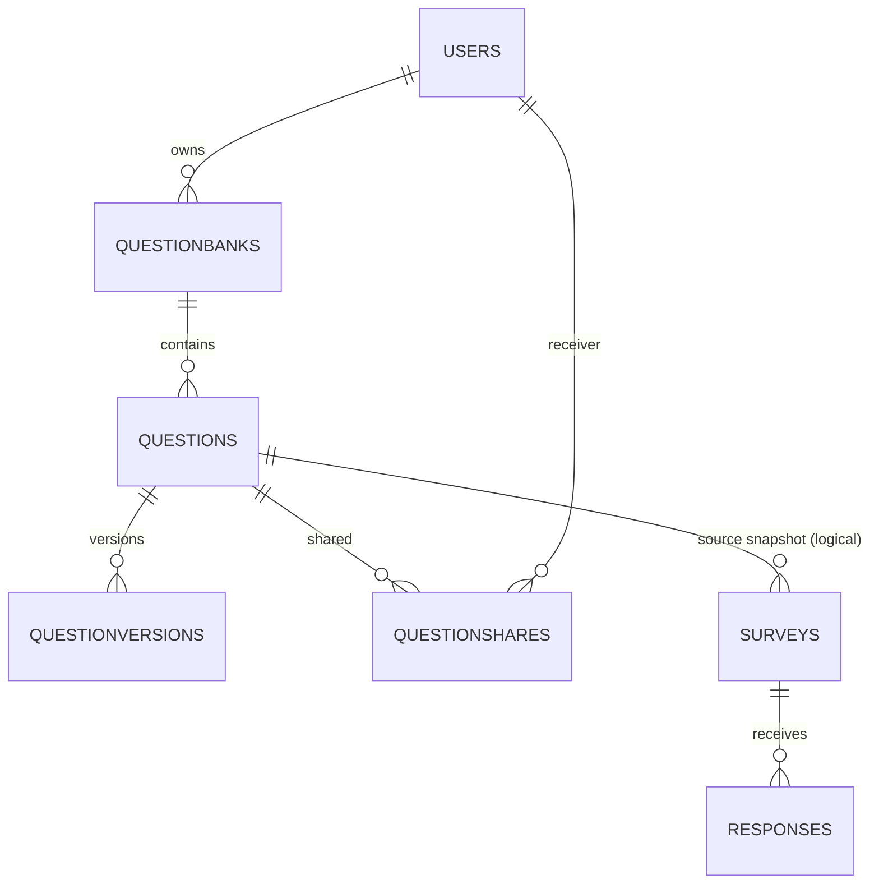

# 八、第二阶段需求分析与设计

## 8.1 变更背景

系统上线后，用户反馈集中在“题目不能复用、修改题目会影响旧问卷、看不到题目的历史和使用范围”。本次变更不是重写系统，而是在第一阶段基础上新增：

1. 常用题目保存到题库，可重复使用；
2. 题目可以共享给其他用户；
3. 修改题目不影响已经做好的问卷；
4. 记录题目修改历史，可恢复旧版本；
5. 同一题的不同版本可以同时存在；
6. 查看题目被哪些问卷使用；
7. 管理题库；
8. 查看单道题跨问卷的统计结果。

对应原始需求文档：`大作业一：需求变更.docx`。

## 8.2 变更带来的核心问题

第一阶段的数据模型是：

```text
Survey.questions[] = { qid, type, title, options, jumps, ... }
```

题目直接嵌在问卷里，没有独立的题目 ID。它适合第一阶段，但无法支撑：

| 新需求 | 第一阶段的问题 |
| --- | --- |
| 一个题被多个问卷使用 | 题目没有独立实体，只能复制文本 |
| 修改不影响旧问卷 | 题目和问卷绑死，无法区分“原题”和“快照” |
| 版本历史 | 没有版本表，无法记录 v1/v2/v3 |
| 查看被哪些问卷使用 | 没有稳定的题目 ID 可反查 |
| 跨问卷统计 | 统计只按 `surveyId`，不知道多份问卷里的哪道题是同一道 |

因此必须引入**题目实体**和**不可变版本**，同时保留第一阶段的“问卷内题目快照”，避免破坏旧数据和旧 API。

## 8.3 设计原则

1. **不推倒重做**：保留 `Survey.questions` 嵌入结构，新增可选来源字段；第一阶段问卷不需要迁移即可继续使用。
2. **逻辑题与版本分离**：`Question` 是可复用身份，`QuestionVersion` 是不可变内容。
3. **问卷保存快照**：Survey 中仍然保存完整题目内容，只额外记录来源 `questionId/versionId`。题库改版不影响快照。
4. **共享是使用权**：被共享者可以查看/使用/另存，不能修改原题。
5. **统计按来源 ID**：Response.answers 新增 `questionId/questionVersionId`，跨问卷统计直接按题目 ID 聚合。
6. **旧数据优先**：新字段都有默认值/null，旧文档不迁移也能读；迁移脚本可重复执行。

## 8.4 新增数据模型

### 8.4.1 集合总览



新增四个集合：

| 集合 | 粒度 | 作用 |
| --- | --- | --- |
| `questionbanks` | 一个题库 | 用户的题目集合，支持默认题库和自定义题库 |
| `questions` | 一道逻辑题 | 稳定 ID、所有者、题库、当前版本指针 |
| `questionversions` | 一个版本 | 不可变的内容快照，v1/v2/v3 |
| `questionshares` | 一条共享 | 题目 → 被共享用户，唯一索引防重复 |

### 8.4.2 QuestionBank

```javascript
{
  _id, schemaVersion: 2,
  ownerId, name: "课程常用题", description,
  isDefault: false,
  createdAt, updatedAt
}
```

- 每个用户默认题库由系统懒创建；
- `{ownerId, name}` 唯一；
- `{ownerId, isDefault}` 部分唯一索引，保证一个用户只有一个默认题库。

### 8.4.3 Question（逻辑题）

```javascript
{
  _id, schemaVersion: 2,
  ownerId, bankId,
  title: "你的年龄段", type: "single",
  currentVersion: 2,
  currentVersionId: ObjectId(...),
  archivedAt: null,
  forkedFromQuestionId: ObjectId | null,
  forkedFromVersionId: ObjectId | null,
  createdAt, updatedAt
}
```

- `title/type` 是当前版本的缓存，列表查询不需要反查版本；
- `currentVersionId` 指向当前版本；
- `forkedFrom...` 记录“另存自哪道题的哪个版本”；
- `archivedAt` 软归档，不物理删除，避免历史引用断裂。

### 8.4.4 QuestionVersion（不可变版本）

```javascript
{
  _id, questionId, ownerId,
  version: 2,
  title, type, options,
  minSelect, maxSelect, minLength, maxLength, min, max, integerOnly,
  parentVersionId: ObjectId,       // 从哪个版本改来
  restoredFromVersionId: ObjectId, // 如果是恢复，来自哪个旧版本
  changeNote: "修改题干",
  createdBy, createdAt
}
```

- **只新增，不更新**；`{questionId, version}` 唯一；
- 修改 = 新版本 + 更新 Question 指针；
- 恢复 = 复制旧版本内容成新版本，`restoredFromVersionId` 指向旧版本；
- 类型在版本之间不可变，保证跨版本统计口径一致。

### 8.4.5 QuestionShare（共享）

```javascript
{
  _id, questionId, ownerId, sharedWithUserId,
  permission: "use",
  createdAt
}
```

- `{questionId, sharedWithUserId}` 唯一；
- 只授予 `use`：查看、用于问卷、另存；
- 编辑、共享、使用情况、跨问卷统计仍只属于所有者；
- 撤销共享不影响已经保存的问卷快照。

### 8.4.6 Survey 的兼容扩展

在原有 `questions[]` 每道题上增加可选字段：

```javascript
sourceQuestionId: ObjectId | null,
sourceVersionId: ObjectId | null,
sourceVersion: Number | null
```

- 普通第一阶段题目保持 null；
- 题库题保存“来源 + 完整内容快照”；
- 发布后仍锁定结构（第一阶段规则继续生效）；
- 旧 API 字段不删除，前端可忽略新字段。

### 8.4.7 Response 的兼容扩展

在原有 answers[] 每项上增加：

```javascript
questionId: ObjectId | null,
questionVersionId: ObjectId | null
```

- 提交时根据 Survey 中题目的来源字段补齐；
- 跨问卷统计按 `answers.questionId` 聚合；
- 第一阶段答卷没有这两个字段，仍可正常按问卷统计。

## 8.5 版本与快照的关系

```text
Question Q（逻辑题）
  ├─ v1（不可变）──→ Survey A 的 q1 快照（sourceVersionId=v1）
  ├─ v2（不可变）──→ Survey B 的 q1 快照（sourceVersionId=v2）
  └─ v3（恢复自 v1，不可变）──→ 当前版本
```

- 修改 Q 生成 v2：Survey A 的 q1 内容不变；
- 恢复 v1 生成 v3：Survey A/B 也不变；
- 不同问卷可以引用不同版本；
- 新的问卷默认使用当前版本。

这是“旧问卷保持原内容”和“同一题不同版本共存”的核心。

## 8.6 共享与权限模型

| 操作 | 所有者 | 被共享者 | 其他人 |
| --- | --- | --- | --- |
| 查看题目/版本 | 是 | 是 | 否 |
| 在问卷中使用 | 是 | 是 | 否 |
| 修改题目（生成新版本） | 是 | 否 | 否 |
| 共享/取消共享 | 是 | 否 | 否 |
| 查看使用情况 | 是 | 否 | 否 |
| 查看跨问卷统计 | 是 | 否 | 否 |
| 另存为新题 | 是 | 是 | 否 |
| 归档 | 是 | 否 | 否 |

设计理由：

- 共享的目标是“复用”，不是协作编辑；直接编辑别人的题会破坏对方问卷语义；
- 需要修改时，被共享者可以“另存为新题”，得到自己的 v1；
- 所有跨问卷数据仅所有者可见，避免暴露他人问卷的回答。

## 8.7 题库管理

- 默认题库：用户第一次访问题库/创建题目时自动创建；
- 自定义题库：用户可创建、重命名、删除空题库；
- 题目必须属于一个题库；
- 题库列表显示题目数量；
- 共享题目仍归原所有者题库，被共享者可在“共享给我”中查看。

## 8.8 使用情况与跨问卷统计

### 使用情况

```javascript
Survey.find({ 'questions.sourceQuestionId': questionId })
```

返回每份使用问卷的标题、状态、qid、版本。多键索引支撑。

### 跨问卷统计

Response 提交时写入：

```javascript
answers: [
  { qid, value, questionId, questionVersionId }
]
```

统计聚合：

```javascript
Response.aggregate([
  { $match: { 'answers.questionId': questionId } },
  { $unwind: '$answers' },
  { $match: { 'answers.questionId': questionId } },
  { $group: {
      _id: { value, surveyId, versionId },
      count: { $sum: 1 }
  }}
])
```

再按题型组装：

- 单选/多选：按选项 key 汇总，按版本拆分，label 取各版本；
- 数字：总体平均/最小/最大，按版本拆分；
- 文本：原文列表，按版本拆分；
- 统计同时返回使用问卷列表、总答卷数、回答该题人数、版本数。

## 8.9 API 变化

新增：

| 方法 | 路径 | 说明 |
| --- | --- | --- |
| GET | `/api/banks` | 题库列表（含默认题库） |
| POST | `/api/banks` | 创建题库 |
| PUT/DELETE | `/api/banks/:id` | 重命名/删除空题库 |
| GET | `/api/questions` | 我的/共享/全部题目，支持搜索、题库筛选 |
| POST | `/api/questions` | 创建题目 v1 |
| GET | `/api/questions/:id` | 题目详情（可指定 version） |
| PUT | `/api/questions/:id` | 修改并生成新版本 |
| DELETE | `/api/questions/:id` | 归档 |
| GET | `/api/questions/:id/versions` | 版本历史 |
| POST | `/api/questions/:id/restore` | 恢复旧版本为新版本 |
| POST | `/api/questions/:id/fork` | 另存为新题 |
| POST | `/api/questions/:id/share` | 按用户名共享 |
| GET/DELETE | `/api/questions/:id/shares` | 共享列表/取消 |
| GET | `/api/questions/:id/usage` | 被哪些问卷使用 |
| GET | `/api/questions/:id/stats` | 跨问卷单题统计 |

原有 `/api/surveys`、`/api/responses`、`/api/auth` 接口保持兼容，只新增可选字段。

## 8.10 前端页面

| 页面 | 功能 |
| --- | --- |
| `library.html` | 题库侧栏、我的/共享题目、创建/编辑、历史、恢复、共享、使用情况、统计入口 |
| `question-stats.html` | 跨问卷总体分布、按版本拆分、使用问卷表 |
| `edit.html` | 新增“从题库添加”，显示来源 vN，保存时保留 source 字段 |
| `dashboard.html` | 新增“题目库”入口 |

## 8.11 数据迁移与兼容

新增字段均可为空，旧数据不需要先迁移。提供 `scripts/migrate-stage2.js`：

1. 为每个用户补默认题库；
2. 为已有 source 问卷补齐版本号；
3. 为题库来源答卷补 `questionId/questionVersionId`。

执行顺序：

```bash
pnpm db:init
pnpm migrate:stage2   # 可重复执行
pnpm seed
```

## 8.12 需求对照

| 变更需求 | 实现 |
| --- | --- |
| 保存常用题目 | `Question` + `QuestionBank` + `library.html` |
| 新问卷从已有题目选择 | `edit.html` 的“从题库添加” |
| 一个题被多个问卷使用 | 快照引用 + 使用情况查询 |
| 共享给其他用户 | `QuestionShare` + 按用户名共享 |
| 其他用户在自己的问卷使用 | 共享题目可加入问卷，保存快照 |
| 已发布问卷题目不能修改 | 第一阶段发布锁题 + 版本快照 |
| 修改生成新题/新版本 | `PUT /questions/:id` 生成新版本；`fork` 另存 |
| 旧问卷保持原内容 | 快照 + 不可变版本 |
| 查看历史版本 | `GET /questions/:id/versions` + UI |
| 知道从哪个版本改来 | `parentVersionId`、`forkedFrom*` |
| 恢复旧版本 | `POST /questions/:id/restore` |
| 不同版本同时存在 | 版本表唯一 `{questionId, version}` |
| 查看被哪些问卷使用 | `GET /questions/:id/usage` |
| 管理题库 | 默认/自定义题库 + 题目归属 |
| 跨问卷单题统计 | `answers.questionId` 聚合 + `question-stats.html` |

## 8.13 已知边界

- 共享按用户名，不支持公开链接/团队；
- 跨问卷统计只覆盖题库来源题目；
- 版本之间不允许改题型；
- 被共享者在问卷中修改的是本地快照，不会回写题库（UI 有说明）；
- 归档题目不会删除历史版本，但默认列表隐藏；
- 大规模数据下跨问卷聚合需要缓存/物化，当前课程数据量足够。
