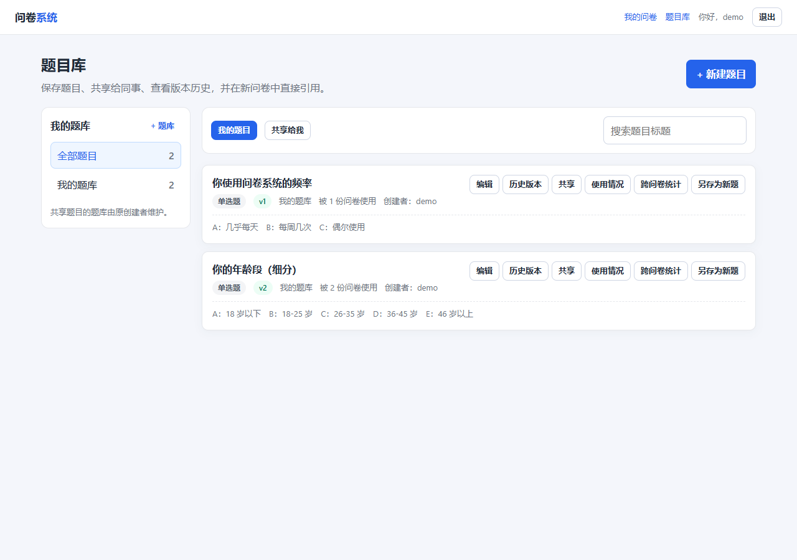
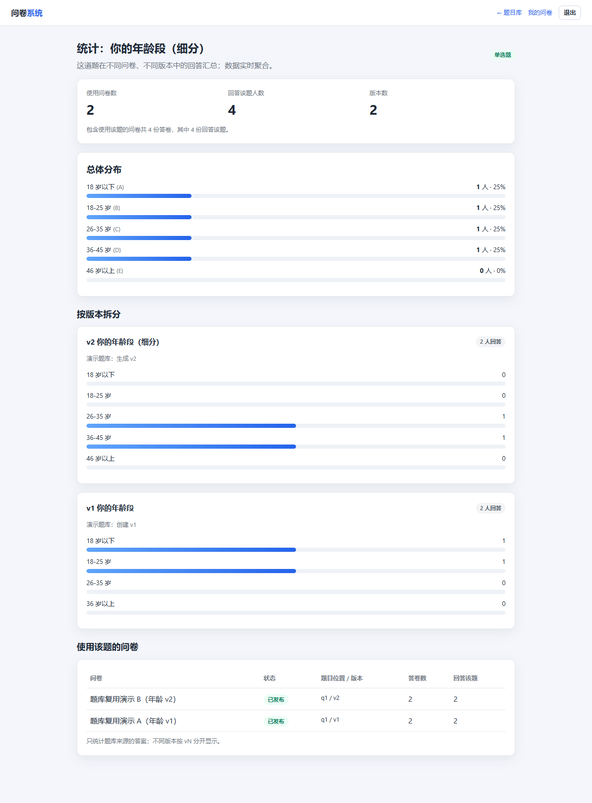

# 十、第二阶段项目完成报告

| 项目 | 内容 |
| --- | --- |
| 课程项目 | 基于 MongoDB 的问卷系统开发 |
| 阶段 | 第二阶段：题目库、版本、共享与跨问卷统计 |
| 技术栈 | Node.js + Express + MongoDB + Mongoose + 原生前端 |
| 报告日期 | 2026-10-22 |
| 姓名/学号 | ____________________ |

---

## 摘要

第二阶段在原有问卷系统上增量实现了题目库、题目共享、不可变版本、版本恢复、使用情况查询和跨问卷单题统计。

核心设计是“**逻辑题目 + 不可变版本 + 问卷快照**”：

- `Question` 保存稳定身份和当前版本指针；
- `QuestionVersion` 保存 v1/v2/v3 的不可变内容；
- `Survey.questions[]` 仍保存完整题目内容，只增加 `sourceQuestionId/sourceVersionId`；
- 修改题库只生成新版本，不改变任何旧问卷；
- `Response.answers[]` 增加 `questionId/questionVersionId`，让跨问卷统计可以直接按题目聚合。

第二阶段保留第一阶段全部接口和 70 个测试，并新增 11 个测试；全量 **81 passed**。旧数据不需要删除或重建，新字段均可为空。

---

## 1. 第二阶段目标

来自 `大作业一：需求变更.docx` 的八项要求：

1. 保存常用题目，重复使用；
2. 把题目共享给其他用户；
3. 修改题目不影响已经做好的问卷；
4. 记录题目修改历史，可恢复；
5. 同一题不同版本可以同时存在；
6. 查看题目被哪些问卷使用；
7. 建立/管理题库；
8. 查看单道题跨问卷统计。

## 2. 第一阶段原设计

### 2.1 数据模型

```javascript
Survey {
  ownerId, title, status, shareCode,
  questions: [{
    qid, type, title, options, required, order,
    minSelect, maxSelect, minLength, maxLength, min, max, integerOnly,
    jumps
  }]
}

Response {
  surveyId, respondentId, visitedPath,
  answers: [{ qid, value }]
}
```

### 2.2 原设计优点

- 填写页一次读取整卷；
- 跳转规则和题目一起加载；
- 发布后锁题，历史答卷的 qid 语义稳定；
- 统计按 `surveyId` 聚合，简单可靠。

### 2.3 原设计无法满足的新需求

| 新需求 | 原设计问题 |
| --- | --- |
| 一题多问卷 | 没有独立题目身份，只能复制文本 |
| 修改不影响旧问卷 | 题目和问卷绑定，没有版本 |
| 历史/恢复 | 没有版本集合 |
| 查看使用范围 | 没有稳定题目 ID 可反查 |
| 共享 | 没有所有者/共享关系 |
| 跨问卷统计 | 不知道不同问卷里的哪道题是同一道 |

## 3. 是否需要修改原设计

**需要扩展，但不需要推倒重来。**

保留：

- 第一阶段 `Survey.questions` 嵌入快照；
- 原有 API 路径和字段；
- 发布锁题、校验、跳转、统计逻辑；
- 旧数据可直接读取。

新增：

- 四个集合：题库、逻辑题、版本、共享；
- Survey 上的来源字段；
- Response 答案上的来源字段；
- 题库/版本/共享/统计页面和接口。

这样既满足新需求，又保证第一阶段功能不被删除。

## 4. 数据结构变化

### 4.1 新增集合

| 集合 | 关键字段 | 作用 |
| --- | --- | --- |
| `questionbanks` | ownerId, name, isDefault | 题库 |
| `questions` | ownerId, bankId, currentVersionId, forkedFrom* | 逻辑题 |
| `questionversions` | questionId, version, content, parentVersionId, restoredFromVersionId | 不可变版本 |
| `questionshares` | questionId, sharedWithUserId, permission | 共享 |

### 4.2 Survey 扩展

```javascript
questions: [{
  // 第一阶段原字段完全保留
  qid, type, title, options, required, order, constraints, jumps,
  // 第二阶段可选字段
  sourceQuestionId: ObjectId | null,
  sourceVersionId: ObjectId | null,
  sourceVersion: Number | null
}]
```

**为什么还保存完整内容？**

- 第一阶段填写/统计代码不改也能工作；
- 题库被归档/共享撤销后，旧问卷仍可打开；
- 不依赖题库当前版本，历史语义固定；
- 代价是内容冗余，但题目数量有限（≤100），可接受。

### 4.3 Response 扩展

```javascript
answers: [{
  qid, value,
  questionId: ObjectId | null,
  questionVersionId: ObjectId | null
}]
```

**为什么把 questionId 冗余到答案里？**

- 跨问卷统计不需要先扫描 Survey 再拼 qid；
- 直接 `$match: {'answers.questionId': id}`；
- 对旧答卷兼容：字段为空时仍按原问卷统计。

### 4.4 索引变化

| 索引 | 用途 |
| --- | --- |
| `surveys.questions.sourceQuestionId` | 反查使用题目 |
| `surveys.questions.sourceVersionId` | 按版本反查 |
| `responses.answers.questionId + submittedAt` | 跨问卷统计 |
| `questionshares.{questionId, sharedWithUserId}` unique | 防重复共享 |
| `questionversions.{questionId, version}` unique | 防重复版本 |
| `questionbanks.{ownerId, name}` unique | 题库重名 |
| `questionbanks.{ownerId, isDefault}` partial unique | 一个默认题库 |

## 5. 程序调整

### 5.1 新增模块

- `models/QuestionBank.js`
- `models/Question.js`
- `models/QuestionVersion.js`
- `models/QuestionShare.js`
- `services/questionLibrary.js`：默认题库、权限、内容校验、创建/追加版本
- `services/questionStats.js`：跨问卷聚合
- `routes/banks.js`
- `routes/questions.js`
- `public/library.html`
- `public/question-stats.html`

### 5.2 修改模块

| 模块 | 修改 |
| --- | --- |
| `models/Survey.js` | 增加 source 字段和索引，schemaVersion 默认 2 |
| `models/Response.js` | answers 增加 questionId/versionId，索引 |
| `shared/survey-engine.js` | normalizeQuestion 保留 source 字段 |
| `routes/surveys.js` | 保存问卷时校验来源权限/版本，固定 sourceVersion |
| `routes/responses.js` | 提交时按 survey 题目补齐 questionId/versionId |
| `public/edit.html` | 新增“从题库添加”、来源提示、保存 source 字段 |
| `public/dashboard.html` | 新增题目库入口 |
| `scripts/init-db.js` | 七集合 validator、索引 |
| `scripts/seed.js` | 题库/版本/两份复用问卷/答卷 |
| `scripts/e2e-ui.js` | 题目库、历史、跨问卷统计、从题库添加 |

### 5.3 版本操作流程

```text
创建：Question + v1
修改：读取当前版本 → 校验 → 创建 vN+1 → 更新 Question.currentVersionId
恢复：读取旧 vK → 复制内容 → 创建 vN+1 → restoredFromVersionId=vK
另存：读取源版本 → 创建新 Question + v1 → forkedFromQuestionId/VersionId
```

没有“覆盖旧版本”的接口。这是保证旧问卷不变的关键。

### 5.4 问卷引用流程

```text
GET /api/questions/:id
  → 前端得到 version 内容
  → 加入编辑页 state，带 sourceQuestionId/sourceVersionId/sourceVersion
  → PUT /api/surveys/:id
  → 服务端校验来源权限/版本
  → 存入 Survey.questions 快照
```

## 6. 兼容性处理

### 6.1 旧数据

- 旧 Survey 没有 source 字段：Mongoose 默认 null，读取无影响；
- 旧 Response 没有 questionId：原有问卷统计仍按 qid；
- 旧用户没有默认题库：第一次访问题库时创建；
- 旧 JSON Schema 集合：`db:init` 用 `collMod` 更新 validator，不删数据。

### 6.2 旧接口

- `POST /api/surveys` 的 questions 可以不带 source 字段；
- `GET /api/surveys/:id` 仍返回 questions，新增字段可为 null；
- `POST /api/responses/:code` 仍按 qid 提交，服务端自动补来源；
- `/survey/:code`、统计页、跳转逻辑不改。

### 6.3 迁移脚本

`pnpm migrate:stage2`：

- 为每个用户补默认题库；
- 为来源问卷补版本；
- 为已有来源答卷补 `questionId/versionId`；
- 可重复执行，不删除旧数据。

### 6.4 旧功能验证

- 第一阶段 70 个测试全部保留；
- 全量 81 个测试通过；
- 浏览器 E2E 继续验证登录、编辑、跳转、必答、登录限制；
- 新增 E2E 验证题目库/历史/跨问卷统计/从题库添加。

## 7. 共享设计

- 共享按用户名，`QuestionShare` 唯一索引；
- `permission` 只有 `use`；
- 所有者可查看共享列表、取消；
- 被共享者可查看/使用/另存，不能编辑/共享/看使用情况/看统计；
- 取消共享后旧问卷快照仍可读取。

## 8. 使用情况与跨问卷统计

### 使用情况

```javascript
Survey.find({ 'questions.sourceQuestionId': questionId })
```

返回问卷标题、状态、qid、版本。

### 跨问卷统计

```javascript
Response.aggregate([
  { $match: { 'answers.questionId': questionId } },
  { $unwind: '$answers' },
  { $match: { 'answers.questionId': questionId } },
  { $group: {
      _id: { value, surveyId, versionId },
      count: { $sum: 1 }
  }}
])
```

- 单选/多选：按选项 key，整体 + 按版本；
- 数字：总体平均/最小/最大，按版本；
- 文本：原文，按版本；
- 同时返回使用问卷、总答卷数、回答人数、版本数。

## 9. 测试结果

### 9.1 自动化

```text
Test Suites: 7 passed, 7 total
Tests:       81 passed, 81 total
```

- 第一阶段原有 70 个；
- 第二阶段新增 11 个（题库、版本、恢复、共享、快照、使用情况、跨问卷统计、权限）。

### 9.2 浏览器 E2E

`pnpm test:e2e` 实际通过：

- 登录、我的问卷；
- 统计页；
- 题目库至少 2 题；
- 年龄题历史 ≥2 版本；
- 跨问卷统计使用问卷数 ≥2；
- 从题库添加题目并出现来源提示；
- 新建/保存/发布/锁题；
- 跳转填写、提交；
- 必答提示、登录限制。

截图：





## 10. 遇到的问题与解决

| # | 问题 | 原因 | 解决 |
| --- | --- | --- | --- |
| 1 | 题库题更新后旧问卷是否变 | 快照与版本关系不清 | Survey 保存完整内容 + sourceVersionId；修改只生成新版本 |
| 2 | 跨问卷统计如何识别同一题 | Response 只有 qid | answers 增 questionId/versionId，提交时补齐 |
| 3 | 旧答卷没有新字段 | 兼容性 | 字段可空，旧统计按 qid；迁移脚本可补 |
| 4 | 默认题库并发创建 | 首次访问同时创建 | 唯一索引 + 冲突回查 |
| 5 | 版本号并发 | 两个请求同时生成 v2 | `{questionId, version}` 唯一索引，冲突返回错误 |
| 6 | 共享用户越权编辑 | 只按 ownerId 判断 | `QuestionShare` + `isOwner` 权限，编辑/共享/统计仅 owner |
| 7 | 恢复旧版是否覆盖历史 | 需求要求保留 v1→v2→v3 | 恢复生成新版本，`restoredFromVersionId` 记录来源 |
| 8 | 题库重名 | 用户可创建同名题库 | `{ownerId, name}` 唯一索引 |
| 9 | 旧 JSON Schema 不允许新字段 | validator 严格 | 更新 `$jsonSchema`，新字段可空 |
| 10 | 从题库添加后保存丢失来源 | 编辑页 buildPayload 未带 source | 补齐 source 字段并在服务端校验 |

## 11. 已知边界

- 共享按用户名，不支持公开链接/团队组织；
- 被共享者在问卷内修改的是本地快照，不回写题库；
- 不同版本不能改题型；
- 跨问卷统计只统计题库来源题目；
- 匿名填写仍无法可靠去重；
- 大数据量聚合需要缓存/物化；
- 未做共享并发压力测试。

## 12. 结论

第二阶段完成情况：

| 需求 | 状态 |
| --- | --- |
| 保存常用题目 | 完成 |
| 新问卷从题库选择 | 完成 |
| 一题多问卷 | 完成（快照） |
| 共享给其他用户 | 完成 |
| 修改不影响旧问卷 | 完成（不可变版本 + 快照） |
| 历史版本/来源 | 完成 |
| 恢复旧版本 | 完成（生成新版本） |
| 不同版本共存 | 完成 |
| 查看使用问卷 | 完成 |
| 题库管理 | 完成 |
| 跨问卷单题统计 | 完成 |

本阶段没有删除第一阶段功能，没有重建数据库，没有修改旧 API 的必需字段；通过 81 个测试和浏览器 E2E 验证了新旧功能共存。
